mRemoteNG full test suite compliance

Complete, unfiltered `mRemoteNGTests` runs for every security branch, built and tested on the owned
Windows lab client in its signed-in desktop session (session 1). Each run is compared test by test
with the unchanged upstream base `v1.78.2-dev` in the same environment. Accepted means: the build
succeeds, no test is aborted, errors or times out, every failure also fails upstream, every upstream
test runs, the machine policy matches the environment and an unmodified desktop screenshot exists.
Upstream itself fails the same tests (mainly CSV deserialization, STA-thread and UI timing tests).

Reproduce with the commands in [README.md](README.md), section "Full test suite". Raw TRX files, logs,
hashes and host timestamps stay in the ignored `work/full-suite/` directory.

Without machine policy

GPO link disabled; HKLM\SOFTWARE\Policies\mRemoteNG\Security absent. Windows EnterpriseEval build 26300.9711, MSBuild 18.11.1.51303, .NET SDK 10.0.403. Upstream `e3b0108e`: 2362 tests, 2115 passed, 247 failed.

| Branch | Commit | Archive SHA-256 | Total | Passed | Failed (all upstream) | New tests | Result | Screenshot |
|---|---|---|---:|---:|---:|---:|---|---|
| `upstream/v1.78.2-dev` | `e3b0108e` | `e90c740ed53ee43c…` | 2362 | 2115 | 247 (247) | 0 (0 failed) | accepted | [desktop](reports/compliance/no-policy/upstream_v1.78.2-dev.png) |
| `fix/atomic-connection-file-writes` | `804cbfce` | `33faf86252d144b2…` | 2365 | 2118 | 247 (247) | 3 (0 failed) | accepted | [desktop](reports/compliance/no-policy/fix_atomic-connection-file-writes.png) |
| `fix/password-dialog-validation` | `e6beec3c` | `fbe4c72ca3fcaa11…` | 2367 | 2120 | 247 (247) | 5 (0 failed) | accepted | [desktop](reports/compliance/no-policy/fix_password-dialog-validation.png) |
| `fix/credential-export-restrictions` | `c1758b0e` | `989547fed2d0fed0…` | 2365 | 2118 | 247 (247) | 3 (0 failed) | accepted | [desktop](reports/compliance/no-policy/fix_credential-export-restrictions.png) |
| `feat/security-policy-core` | `7ed355ad` | `f7f75c711e2fdb25…` | 2382 | 2135 | 247 (247) | 20 (0 failed) | accepted | [desktop](reports/compliance/no-policy/feat_security-policy-core.png) |
| `feat/nonpersistent-unlock-policy` | `0035b6b1` | `73bb27426674b3cf…` | 2387 | 2140 | 247 (247) | 25 (0 failed) | accepted | [desktop](reports/compliance/no-policy/feat_nonpersistent-unlock-policy.png) |
| `feat/secure-export-policy` | `d469eb11` | `77907b567e4bcd89…` | 2405 | 2158 | 247 (247) | 43 (0 failed) | accepted | [desktop](reports/compliance/no-policy/feat_secure-export-policy.png) |
| `feat/master-password-policy` | `4d1f59c4` | `486bdbfea14749d6…` | 2411 | 2164 | 247 (247) | 49 (0 failed) | accepted | [desktop](reports/compliance/no-policy/feat_master-password-policy.png) |
| `fix/encrypted-secret-storage` | `1b01c34e` | `f43003e11dccca38…` | 2435 | 2188 | 247 (247) | 73 (0 failed) | accepted | [desktop](reports/compliance/no-policy/fix_encrypted-secret-storage.png) |
| `feat/security-gpo-templates` | `c651c518` | `2af967533f687e7f…` | 2423 | 2176 | 247 (247) | 61 (0 failed) | accepted | [desktop](reports/compliance/no-policy/feat_security-gpo-templates.png) |
| `build/approved-release-manifest` | `60ca164f` | `881dbb298efbfcc8…` | 2423 | 2176 | 247 (247) | 61 (0 failed) | accepted | [desktop](reports/compliance/no-policy/build_approved-release-manifest.png) |
| `deploy/company-app-control` | `ffbd4c0a` | `6e1f2cc06a3971f5…` | 2423 | 2176 | 247 (247) | 61 (0 failed) | accepted | [desktop](reports/compliance/no-policy/deploy_company-app-control.png) |
| `audit/company-security-requirements` | `367fd141` | `097272f295d15909…` | 2362 | 2115 | 247 (247) | 0 (0 failed) | accepted | [desktop](reports/compliance/no-policy/audit_company-security-requirements.png) |
| `integration/enterprise-security` | `b97f63b6` | `b4a6d0bf79e7dbba…` | 2450 | 2203 | 247 (247) | 88 (0 failed) | accepted | [desktop](reports/compliance/no-policy/integration_enterprise-security.png) |
| `integration/company-approved-build` | `88fa039a` | `ea1ccc7d5ed20301…` | 2450 | 2203 | 247 (247) | 88 (0 failed) | accepted | [desktop](reports/compliance/no-policy/integration_company-approved-build.png) |

Without machine policy: `upstream/v1.78.2-dev`

Without machine policy: `fix/atomic-connection-file-writes`

Without machine policy: `fix/password-dialog-validation`

Without machine policy: `fix/credential-export-restrictions`

Without machine policy: `feat/security-policy-core`

Without machine policy: `feat/nonpersistent-unlock-policy`

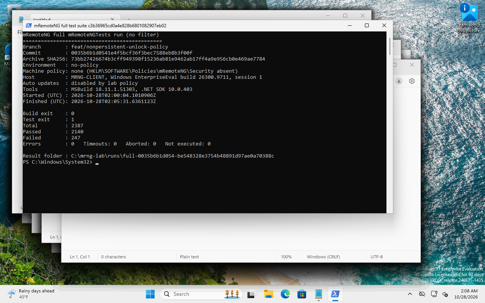

Without machine policy: `feat/secure-export-policy`

Without machine policy: `feat/master-password-policy`

Without machine policy: `fix/encrypted-secret-storage`

Without machine policy: `feat/security-gpo-templates`

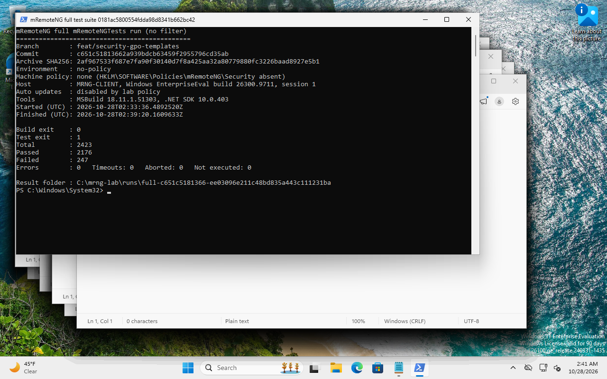

Without machine policy: `build/approved-release-manifest`

Without machine policy: `deploy/company-app-control`

Without machine policy: `audit/company-security-requirements`

Without machine policy: `integration/enterprise-security`

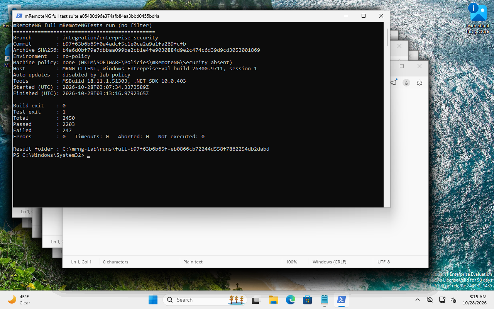

Without machine policy: `integration/company-approved-build`

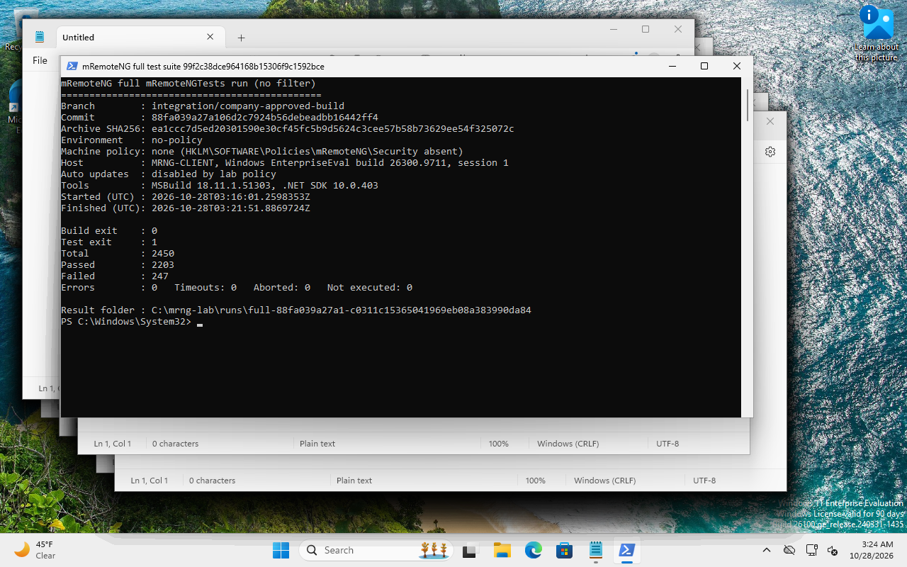

With the lab security GPO

mRemoteNG Lab Security Acceptance linked to the client OU. Windows EnterpriseEval build 26300.9711, MSBuild 18.11.1.51303, .NET SDK 10.0.403. Upstream `e3b0108e`: 2362 tests, 2115 passed, 247 failed.

| Branch | Commit | Archive SHA-256 | Total | Passed | Failed (all upstream) | New tests | Result | Screenshot |
|---|---|---|---:|---:|---:|---:|---|---|
| `upstream/v1.78.2-dev` | `e3b0108e` | `e90c740ed53ee43c…` | 2362 | 2115 | 247 (247) | 0 (0 failed) | accepted | [desktop](reports/compliance/gpo/upstream_v1.78.2-dev.png) |
| `fix/atomic-connection-file-writes` | `804cbfce` | `33faf86252d144b2…` | 2365 | 2118 | 247 (247) | 3 (0 failed) | accepted | [desktop](reports/compliance/gpo/fix_atomic-connection-file-writes.png) |
| `fix/password-dialog-validation` | `e6beec3c` | `fbe4c72ca3fcaa11…` | 2367 | 2120 | 247 (247) | 5 (0 failed) | accepted | [desktop](reports/compliance/gpo/fix_password-dialog-validation.png) |
| `fix/credential-export-restrictions` | `c1758b0e` | `989547fed2d0fed0…` | 2365 | 2118 | 247 (247) | 3 (0 failed) | accepted | [desktop](reports/compliance/gpo/fix_credential-export-restrictions.png) |
| `feat/security-policy-core` | `7ed355ad` | `f7f75c711e2fdb25…` | 2382 | 2135 | 247 (247) | 20 (0 failed) | accepted | [desktop](reports/compliance/gpo/feat_security-policy-core.png) |
| `feat/nonpersistent-unlock-policy` | `0035b6b1` | `73bb27426674b3cf…` | 2387 | 2140 | 247 (247) | 25 (0 failed) | accepted | [desktop](reports/compliance/gpo/feat_nonpersistent-unlock-policy.png) |
| `feat/secure-export-policy` | `d469eb11` | `77907b567e4bcd89…` | 2405 | 2158 | 247 (247) | 43 (0 failed) | accepted | [desktop](reports/compliance/gpo/feat_secure-export-policy.png) |
| `feat/master-password-policy` | `4d1f59c4` | `486bdbfea14749d6…` | 2411 | 2164 | 247 (247) | 49 (0 failed) | accepted | [desktop](reports/compliance/gpo/feat_master-password-policy.png) |
| `fix/encrypted-secret-storage` | `1b01c34e` | `f43003e11dccca38…` | 2435 | 2188 | 247 (247) | 73 (0 failed) | accepted | [desktop](reports/compliance/gpo/fix_encrypted-secret-storage.png) |
| `feat/security-gpo-templates` | `c651c518` | `2af967533f687e7f…` | 2423 | 2176 | 247 (247) | 61 (0 failed) | accepted | [desktop](reports/compliance/gpo/feat_security-gpo-templates.png) |
| `build/approved-release-manifest` | `60ca164f` | `881dbb298efbfcc8…` | 2423 | 2176 | 247 (247) | 61 (0 failed) | accepted | [desktop](reports/compliance/gpo/build_approved-release-manifest.png) |
| `deploy/company-app-control` | `ffbd4c0a` | `6e1f2cc06a3971f5…` | 2423 | 2176 | 247 (247) | 61 (0 failed) | accepted | [desktop](reports/compliance/gpo/deploy_company-app-control.png) |
| `audit/company-security-requirements` | `367fd141` | `097272f295d15909…` | 2362 | 2115 | 247 (247) | 0 (0 failed) | accepted | [desktop](reports/compliance/gpo/audit_company-security-requirements.png) |
| `integration/enterprise-security` | `b97f63b6` | `b4a6d0bf79e7dbba…` | 2450 | 2203 | 247 (247) | 88 (0 failed) | accepted | [desktop](reports/compliance/gpo/integration_enterprise-security.png) |
| `integration/company-approved-build` | `88fa039a` | `ea1ccc7d5ed20301…` | 2450 | 2203 | 247 (247) | 88 (0 failed) | accepted | [desktop](reports/compliance/gpo/integration_company-approved-build.png) |

With the lab security GPO: `upstream/v1.78.2-dev`

With the lab security GPO: `fix/atomic-connection-file-writes`

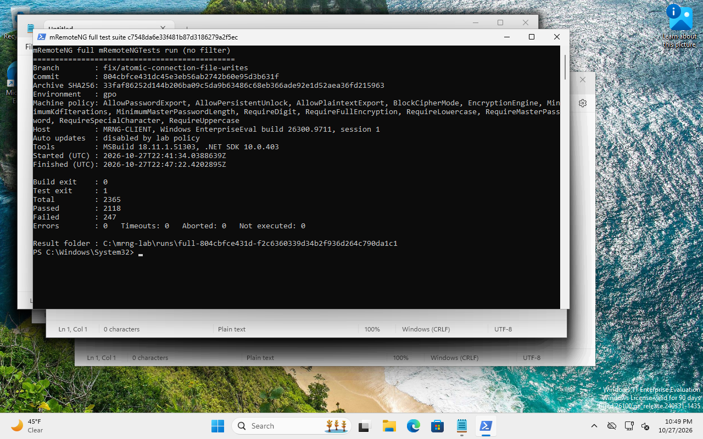

With the lab security GPO: `fix/password-dialog-validation`

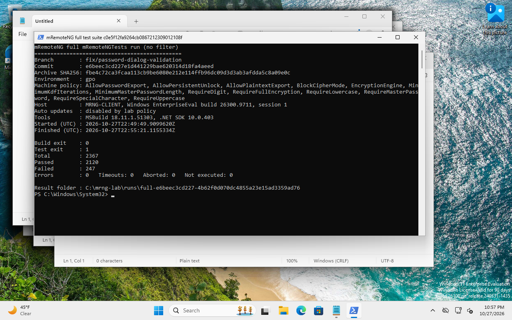

With the lab security GPO: `fix/credential-export-restrictions`

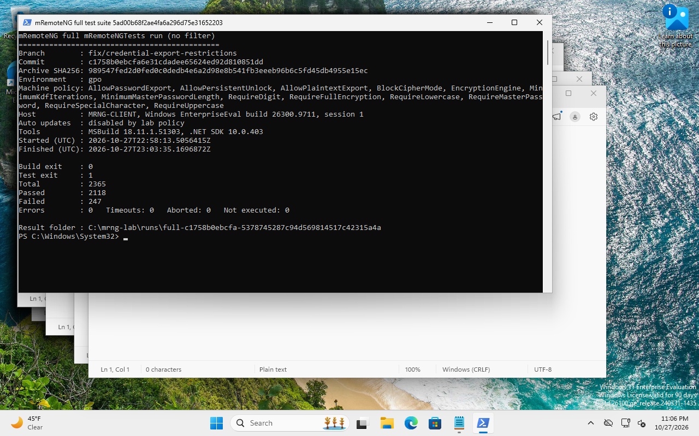

With the lab security GPO: `feat/security-policy-core`

With the lab security GPO: `feat/nonpersistent-unlock-policy`

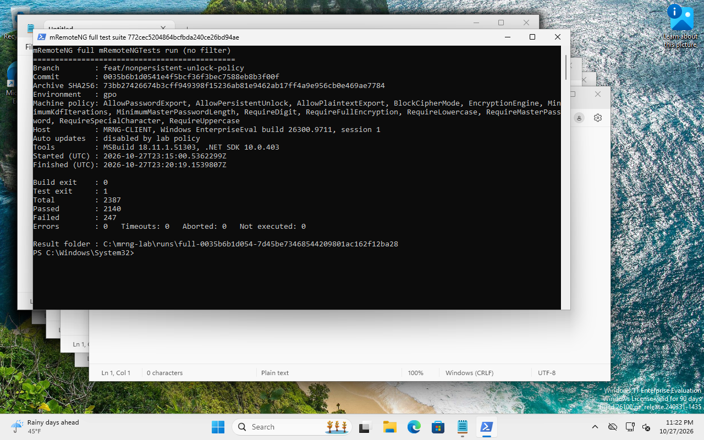

With the lab security GPO: `feat/secure-export-policy`

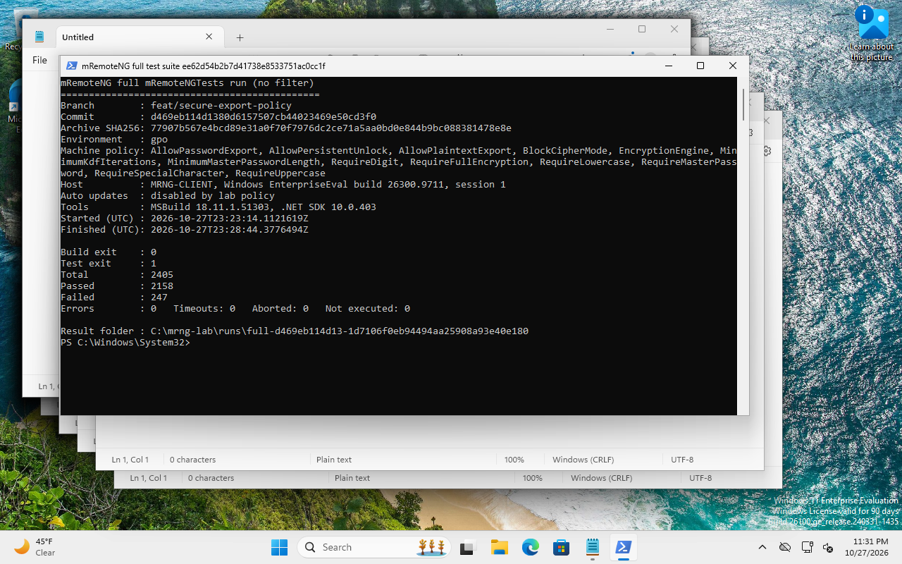

With the lab security GPO: `feat/master-password-policy`

With the lab security GPO: `fix/encrypted-secret-storage`

With the lab security GPO: `feat/security-gpo-templates`

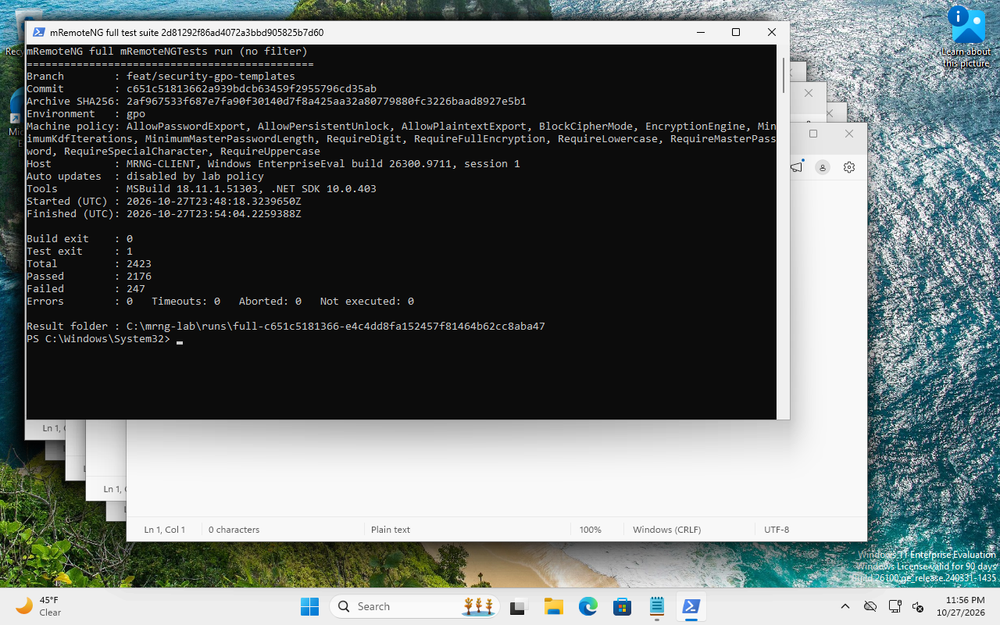

With the lab security GPO: `build/approved-release-manifest`

With the lab security GPO: `deploy/company-app-control`

With the lab security GPO: `audit/company-security-requirements`

With the lab security GPO: `integration/enterprise-security`

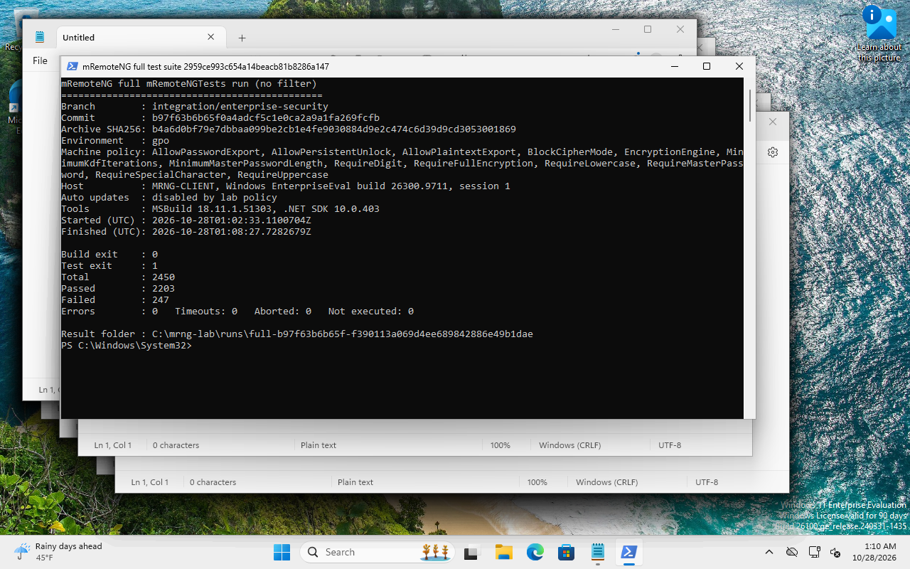

With the lab security GPO: `integration/company-approved-build`

